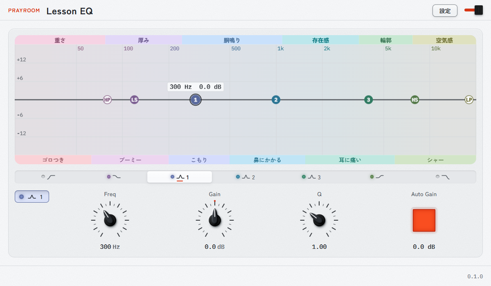
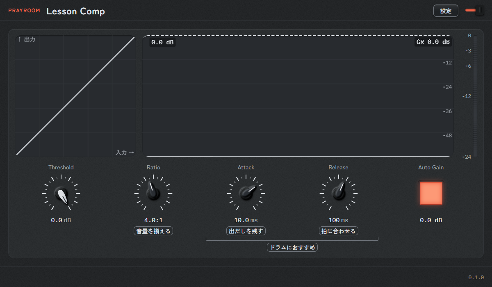

# Lesson EQ / Lesson Comp

Windows 用の VST3 エフェクト 2 本、イコライザー（Lesson EQ）とコンプレッサー（Lesson Comp）です。周波数の帯や設定の意味を、画面の言葉で確かめながら使えるように作ってあります。




## 特長

**Lesson EQ**

- 7 バンド: ハイパス、ローシェルフ、ベル 3 本、ハイシェルフ、ローパス。
- ハイパスとローパスの傾きは 12・24・36・48 dB/oct から選べます。Freq は 20 Hz〜20 kHz、Gain は ±18 dB、ベルの Q は 0.3〜12 です。
- カーブをドラッグして調整できます。入力と出力のスペクトルが重なって見えます。
- 周波数の帯に「重さ」「厚み」「胴鳴り」などの言葉が付き、それぞれが何を指すかを説明の欄で読めます。
- Auto Gain: 設定による音量の変化を打ち消します。

**Lesson Comp**

- Threshold（−60〜0 dB）、Ratio（1:1〜20:1、∞:1）、Attack（0.1〜100 ms）、Release（5〜1000 ms）。Attack と Release は最小で「最速」です。
- 入出力のグラフ、音量の流れ、ゲインリダクションのメーターが見えます。
- Ratio、Attack、Release の値に、効き方を表す短い言葉が付きます。
- Auto Gain。

**共通**

- バイパスは DAW のバイパスと連動します。
- モノラルとステレオに対応します（コンプはステレオをリンクします）。サンプルレートは 44.1〜192 kHz、レイテンシは 0 です。
- 画面の拡大率（100〜200 %）とテーマ（light、dark、studio）は、設定のパネルで変えられます。

## インストール

[Releases](https://github.com/dubmiyako-hue/lesson-plugins/releases) から、次のどちらか一方を取ります。

- **`LessonPlugins-<version>-setup.exe`**: 実行すると、2 本を `C:\Program Files\Common Files\VST3\` に入れます。管理者の確認が出ます。
- **`LessonPlugins-<version>.zip`**: 展開して、中の `install.cmd` を実行します（同じ場所に入ります）。

DAW を閉じてから実行してください。DAW が読み込んでいるプラグインは上書きできません。入れたあと、DAW でプラグインの一覧を読み直します。Ableton Live では、Settings（Ctrl+,）の Plug-Ins で、VST3 のシステムのフォルダを使う切り替えを On にして、Rescan します。

署名をしていないので、Windows が警告を出すことがあります。ファイルの SHA-256 は、Release の `.sha256` で確かめられます。

### アンインストール

exe で入れたときは、Windows の「設定」→「アプリ」から消します。zip で入れたときは、`C:\Program Files\Common Files\VST3\` の `Lesson EQ.vst3` と `Lesson Comp.vst3` を消します。

### 動作条件

- Windows 11（x64）。Windows 10 では確かめていません。
- Microsoft Edge WebView2 ランタイム（Windows 11 には入っています）。無いときは、音は通りますが、画面に案内が 1 行出るだけです。
- Microsoft Visual C++ Redistributable 2015-2022（x64）。無いと、DAW がプラグインを読み込めません。
- VST3 に対応した DAW。

## 設定ファイル

| 場所 | 中身 |
| --- | --- |
| `%APPDATA%\PRAYROOM\settings.json` | 窓の拡大率とテーマ、説明の欄の表示。消すと既定に戻ります |
| `%LOCALAPPDATA%\PRAYROOM\Lesson\WebView2` | WebView2 のデータ |

つまみの値は DAW のセッションに入ります。

## ビルド

### 必要なもの

- Visual Studio の C++（MSVC）。`tools\msvc.cmd` と `tools\build.cmd` の `VCVARS` を、自分の `vcvars64.bat` のパスに直します。
- CMake 3.22 以上、Node.js 20 以上。
- JUCE 9.0.2 に、`third_party/juce-patches/` の 2 本のパッチを当てたもの（手順は `third_party/juce-patches/README.md`）。置き場所は `cmake -DLESSON_JUCE_DIR=<path>` で渡します。パッチが当たっていないと、CMake が止まります。

### 手順

```bat
npm ci
tools\build.cmd Release
```

画面（`plugin/web`）をビルドしてから、C++ をビルドします。できるもの:

- `build-rel\plugin\LessonEQ_artefacts\Release\VST3\Lesson EQ.vst3`
- `build-rel\plugin\LessonComp_artefacts\Release\VST3\Lesson Comp.vst3`

ビルドした 2 本を入れるには `tools\install-vst3.cmd` を使います（`--dry-run` で確かめだけ）。配布物は `python tools\package.py`（zip）と `python tools\package-exe.py`（exe、Inno Setup 6 が要ります）で作ります。

### 試験

```bat
cd build-rel
ctest -j 8
cd ..
npm run web:test
```

- `core_tests`: DSP と、基準データとの一致。
- `plugin_tests`: パラメータ、状態の保存、画面とのやりとり、設定ファイル。
- `rt_alloc_test`: オーディオスレッドでメモリを確保しないこと。
- `web:test`: 画面の言葉と定数。

`tools\validate.cmd Release 10` で、Steinberg の VST3 validator と pluginval（strictness 10）を 2 本に流せます。

`tests/golden/` の基準データは、ブラウザの Web Audio などの出力から作ったものです。作り直す手順は、`tests/golden/gen-*` の各ファイルの冒頭にあります。

## リポジトリの構成

| 場所 | 中身 |
| --- | --- |
| `core/` | DSP（EQ、コンプ、Auto Gain、スペクトル）。JUCE に依存しない C++20 |
| `plugin/` | JUCE のプラグイン本体（`common`、`eq`、`comp`）と、WebView2 で開く画面（`web`） |
| `tests/` | 基準データと、C++ の試験 |
| `tools/` | ビルド、インストール、配布物、検証のスクリプト |
| `third_party/` | JUCE のパッチ、fdlibm、doctest |
| `docs/` | 要件と設計のメモ（日本語） |

画面の部品とデザインのトークンは、デザインシステム PRAYROOM の写し（`plugin/web/design-system/`）です。`tools/sync-prayroom.py` で更新するので、中は直接編集しません。

## ライセンス

[GNU Affero General Public License v3.0](LICENSE)。JUCE を AGPLv3 で使っているためです。

使っているものは次のとおりです。配布物の `licenses/` に、それぞれの全文を入れています。

| もの | ライセンス |
| --- | --- |
| JUCE 9.0.2 | AGPLv3 か、JUCE の商用ライセンス |
| VST3 SDK（JUCE に同梱） | MIT |
| fdlibm（`expf`・`exp`・`sin`・`cos` を写したもの） | Sun Microsystems の告知を残す条件で自由（`third_party/fdlibm/LICENSE`） |
| Zen Kaku Gothic New、IBM Plex Mono（使う文字だけに絞った WOFF） | SIL Open Font License 1.1（`plugin/web/fonts/OFL-*.txt`） |
| Preact | MIT |
| doctest（試験だけ） | MIT（`third_party/doctest/LICENSE.txt`） |
