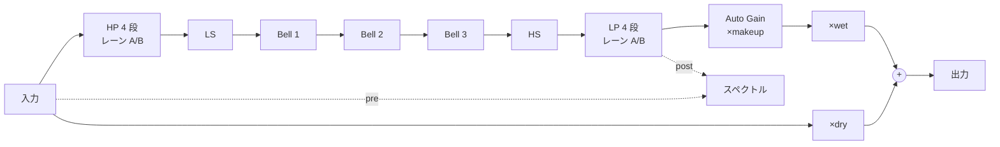
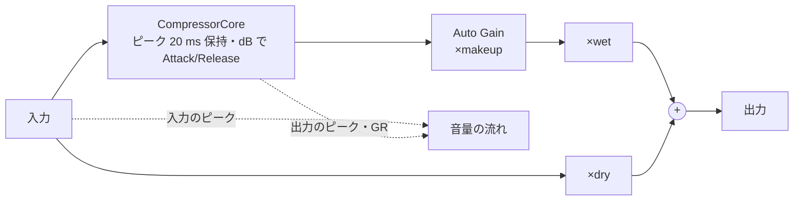

# Lesson EQ / Lesson Comp 設計書

- 日付: 2026-10-31
- 状態: 確定（2026-10-31、ユーザーの確定）
- 前提: [requirements.md](requirements.md)（確定済み、AC-01〜AC-23）
- 根拠: Web アプリ（`D:\work\Claude\mix-course` の `src/dsp.ts`、`src/chain.ts`、`src/compressor.worklet.ts`、`src/params.ts`、`src/character.ts`、`src/ui/`）と、Chrome の実装（Blink の `platform/audio/biquad.cc`、`modules/webaudio/biquad_filter_handler.cc`、`modules/webaudio/realtime_analyser.cc`、2026-10-31 に main から読んだ）

## 変更履歴

| 周 | 日付 | 変更 | 理由 |
| --- | --- | --- | --- |
| — | 2026-10-31 | 初版 | 工程 2 |
| 1 | 2026-10-31 | 正規化のゴールデンを `norm.json` から `params.tsv`（タブ区切り、値の文字と JS の丸めも入れる）に替えた | C++ の試験が JSON の読み取りなしで読める（DECISIONS.md） |

## 1. 信号の流れ

### Lesson EQ



- 13 段のビクアッドは、Web アプリの `EqFilters` と同じ順に直列につなぐ。各段の出力は float に丸める（Web Audio のノードの出力が float32 だから）。
- `post` はビクアッドの後、Auto Gain の前（Web アプリの `post` の analyser と同じ位置）。`pre` は入力。
- wet と dry はバイパスのクロスフェード。Web アプリの `eqWet`・`eqDry` と同じく、足し合わせは float。

### Lesson Comp



- 音量の流れの点は、256 サンプルごとの [入力のピーク、出力のピーク（Auto Gain の前）、GR の最大]。Web アプリのワークレットの `collect` と同じ中身。
- バイパス中もコアは動かし続ける（Web アプリと同じ。表示もそのまま動く）。

## 2. DSP の選定

### 2.1 Web Audio と同じビクアッド（`WebBiquad`）

Chrome の `Biquad` をそのまま写す。

- 係数の入力（周波数、Q、Gain）は float に丸めてから使う。Web Audio の `AudioParam` は float32 で値を持つから。周波数は `f / (0.5 · fs)` で 0〜1 に直す（double）。
- 係数の式と端の扱いは `biquad.cc` のとおり。lowpass・highpass の Q は dB（`10^(Q/20)` に戻す）。シェルフは S = 1 で Q を使わない。peaking は周波数が 0 か 1 で素通し、Q が 0 で `A²`。正規化は `1 / a0` を掛ける（割らない）。
- 処理は直接形 I。係数と状態（x1, x2, y1, y2）は double、各サンプルの `y` は float に丸め、状態にもその float を入れる（`float y = b0*x + b1*x1 + b2*x2 - a1*y1 - a2*y2`）。式の足す順番も同じにする。
- denormal: Chrome はレンダリングの 128 サンプルごとに状態の denormal を 0 にし、レンダリングのスレッドは FTZ・DAZ で動く。プラグインは core の小さな RAII（`lesson::NoDenormals`、MXCSR の FTZ・DAZ を立てる）で常に 0 にする。`processBlock` と単体試験の両方でこれを使う（JUCE の `ScopedNoDenormals` は core から使えないので）。違いが出るのは 1.2e-38 より小さい値だけ。
- `10^x`: Blink の `pow10` は `fdlibm::expf(float(x · ln10))` で、結果は float の精度になる（シェルフ・peaking の A と、lowpass・highpass の Q）。ここは float の丸めが係数に直に入るので、Chromium の `third_party/fdlibm` の `expf` を写す（Sun の fdlibm の許諾。告知を残す）。
- sin・cos は Chrome が fdlibm の double、こちらは MSVC の CRT の double。違いは double の最後の 1 ビット程度で、出力では 1e-12 より小さい見込み（測って確かめる）。

### 2.2 EQ（`Eq`）

- 段の割り当ては `EqFilters.apply` と同じ。HP・LP は 4 段で、オンのときは前から `slope / 12` 段を highpass・lowpass（Q は `butterworthQs(slope / 6)` を dB にしたもの）、残りとオフのときは 0 dB・Q 1 の peaking（素通し）。LS・HS・ベルはオフのとき Gain 0 dB。13 段は常に全部動かす（素通しの段も Chrome と同じ計算をするので、出力のビットまで同じになる）。
- 平滑化: Freq・Gain・Q は、それぞれ `setTargetAtTime(v, t, 0.005)` と同じ式で目標へ近づける（2.5）。平滑化している段だけ、サンプルごとに係数を計算し直す（Chrome もオートメーション中はサンプルごとに計算する）。止まっている段は係数を変えない。
- HP・LP のオン・オフと Slope（要件の食い違いの表）: バンドごとに 4 段のレーンを 2 本持つ。切り替えのとき、新しい設定のレーン（状態は 0 から）を立ち上げ、10 ms のレイズドコサイン `w = 0.5 − 0.5·cos(π·t / T)` で古いレーンから移る。移り終わったら古いレーンを止める。移っているあいだに次の切り替えが来たら、移り終わってから始める。周波数の平滑化は両方のレーンにかける。
- Auto Gain の量（2.4）は τ 5 ms で平滑化した float のゲインで、`float(y · makeup)`。続けて `float(· wet)`、`dry` 側は `float(x · dry)`、足して float。Web Audio の GainNode を 2 つ通るのと同じ丸め。

### 2.3 コンプ（`Compressor`）

`CompressorCore` を 1 行ずつ写す。

- 検出: 全チャンネルの |x| の最大（float）を 48 サンプルの部分最大にまとめ、`round(0.02·fs / 48)` 個のリングで最大をとる。部分最大は double で持ち、リングは float の配列。
- `levelDb = 20·log10(max(level, 1e-9))`、`targetGr`（∞:1 は Ratio ≥ 1000）、`coef = target > gr ? att : rel`、`gr = target + coef·(gr − target)`、`g = 10^(−gr/20)`、`x = float(x · g)`。gr は double。
- パラメータは float に丸める（ワークレットは `Float32Array` で受けるから）。`timeCoef(ms) = ms ≤ 0 ? 0 : exp(−1 / (ms/1000 · fs))`。
- 平滑化（要件の食い違いの表）: Threshold（dB）と `1/Ratio` を τ 5 ms で動かす（∞:1 は 0）。動いているあいだの式は `over − over · invRatio`。止まったら目標の値に合わせ、Web アプリと同じ式（`over − over / ratio`）に戻す。止まっているときのビットが Web アプリと同じになるように。Attack・Release は平滑化しない。係数はブロックの頭で計算する。
- ワークレットは 128 サンプルごとにパラメータを読む。プラグインはホストのブロックごとに読み、平滑化はサンプルごとに進める。設定が止まっていれば、ブロックの長さで音は変わらない（AC-09）。

### 2.4 Auto Gain（`AutoGain`）

- コンプ: `min(24, targetGr(0, T, R) / 2)`。T と R は float に丸めた目標の値。
- EQ: 20 Hz〜20 kHz を対数で 2048 等分した区間の中央の周波数 f_i で、`makeup = clamp(−10·log10( Σ |H(f_i)|²·|K(f_i)|² / Σ |K(f_i)|² ), −24, 24)`。H は 13 段の目標の設定の係数（平滑化の途中の値でなく、止まったときの値。レーンの切り替えの途中も新しい設定）、K は `kWeighting(fs)`（Web アプリの係数の式）。2048 点は、100000 点との差が 0.004 dB 以下になる点の数として測って決めた（44.1・48・96 kHz、ベル 20 Hz〜19 kHz・Q 0.3〜12・±18 dB、シェルフ、HP。いちばん厳しいのは 44.1 kHz の 19 kHz・Q 12 のベル）。
- EQ の計算は重い（全段で約 70 万回の演算）ので、オーディオスレッドで少しずつ進める。目標の設定が変わったら計算を始め、入力 1 サンプルにつき 4 点ずつ進める（2048 点は 512 サンプル、48 kHz で約 11 ms）。計算中に設定が変わったら、終わってからもう一度始める。サンプルの数で進むので、ブロックの長さで結果の出る時刻は変わらない。z と |K|² の表は `prepareToPlay` で作る。
- 量が変わったら、τ 5 ms で新しい量へ近づける（Web アプリの `compMakeup.gain` の `setTargetAtTime`）。Auto Gain のスイッチのオン・オフも同じ（オフは 0 dB）。
- 最初の量: `prepareToPlay` で、今のパラメータの 2048 点を一度に計算し、平滑化をその値から始める。少しずつ進めるのは、そのあとの変化だけ。設定を止めた試験（AC-06、AC-09、AC-12）の頭で、量が 0 から動いて見えることはない。
- ホストが停止中に `processBlock` を呼ばないと、そのあいだは EQ の量の計算が進まない。画面の量は再生を始めてから約 11 ms で追いつく（そのままにする）。
- 画面には、スイッチがオフでも計算した量を出す。

### 2.5 平滑化（`Smoother`）

Chrome の `setTargetAtTime` と同じ（Blink の `audio_param_handler.cc` で確かめた）。値と係数は float。`c = float(1 − exp(−1 / (fs · 0.005)))`、サンプルごとに `v += (target − v) · c`。始めてから 10τ（50 ms）たつか、`|target − v| < 4.54e-5 · |v|`（target が 0 なら `|v| < 4.54e-5`）になったら、target にそろえて止める。止まっている値は目標そのものなので、止まったあとの音は平滑化のない計算と同じになる。

### 2.6 スペクトル（画面用。音には関係しない）

AnalyserNode と同じ計算をプラグインのメッセージのスレッドでする。

- オーディオスレッドは、入力（pre）とビクアッドの後（post）を、チャンネルの平均（Web Audio のモノへの足し合わせ。ステレオは 0.5·(L+R)）にして、それぞれのリングバッファ（16384 サンプル、単一の書き手と単一の読み手）に書く。
- 30 Hz のタイマーで、最新の 8192 サンプルに Blackman 窓（α 0.16）をかけて FFT し、`|X|/8192` を前の値と平滑して、dB にして画面へ送る。Web アプリは画面の更新（60 Hz）ごとに平滑 0.8 をかけるので、30 Hz では 0.8² = 0.64 にして、1 秒あたりの減り方を同じにする。
- 画面へ送るのは 20 kHz・1/24 オクターブ上までのビンの dB（48 kHz で約 3500 個、float の base64）。画面は Web アプリの `spectrum()` をそのまま使って、ピクセルの列ごとに直す。
- FFT の大きさの尺度（Chrome の FFT の出力の倍率）は、Edge で 1 回測ってそろえる（AC-18）。`getFloatFrequencyData` は 0 から平滑を始めるので、比べるときは両方とも平滑を 0 にして、決まったサインとノイズの 8192 サンプルで比べる。

## 3. パラメータ表

ID・名前・範囲・既定値は要件のとおり。JUCE の型と受け渡しは次のとおり。

| 種類 | JUCE の型 | 正規化 | 値の文字 | 受け渡し |
| --- | --- | --- | --- | --- |
| Freq・Gain・Q・Threshold・Ratio・Attack・Release | `AudioParameterFloat` | `NormalisableRange` に `toNorm`・`fromNorm` を渡す（`fromNorm` の刻みの丸めも込み。最速と ∞:1 の切れ目も同じ） | `fmt`（Web アプリと同じ書式） | `getRawParameterValue` の atomic |
| On・Auto Gain・Bypass | `AudioParameterBool` | 0・1 | `On`・`Off` | 同上 |
| Slope | `AudioParameterChoice`（12、24、36、48） | 4 択 | `24 dB/oct` | 同上 |

- JUCE の `AudioParameterFloat` は値を float で持つ。音に使う値は `float(fromNorm(n))` で、これは Web アプリの AudioParam が float32 に丸めるのと同じ（音はそろう）。AC-05 は core の `toNorm`・`fromNorm`（double）を 1e-9 で比べ、JUCE のパラメータの値はその `Math.fround` と一致することを別に確かめる。値の文字は float の値から作るので、999.5 Hz のような切れ目のちょうど上では、Web アプリ（double）と最後の桁が違うことがある。文字を作る関数そのものは Web アプリと同じ（AC-04 の文字の試験は関数を比べる）。
- Bypass は `getBypassParameter()` から返す。プラグインがクロスフェードを自分でするので、JUCE の `processBlockBypassed` は使わない（JUCE は `getBypassParameter` があれば `processBlock` を呼び続ける）。
- 値の文字の数字は、JS の `toFixed` と同じ丸め（ちょうど半分は 0 から遠い方）、`Math.round` と同じ丸め（ちょうど半分は大きい方）にする。C++ の `printf` は半分を偶数へ丸めるので使わない。
- 数値の入力: 単位を省いてよい、`k` は 1000 倍、`∞`・`inf` は ∞:1、`最速` は 0、範囲の外は端へ丸める。読めなければ元の値に戻す。

## 4. スレッドモデル

| スレッド | すること |
| --- | --- |
| オーディオ | `processBlock`: パラメータの atomic を読み、DSP、スペクトルのリングと音量の流れの FIFO に書き、Auto Gain の量を atomic に書く |
| メッセージ | `Bridge` の 30 Hz のタイマー: 変わったパラメータ、Auto Gain の量、音量の流れの点、スペクトルを画面へ送る。画面からの操作をパラメータに渡す（ジェスチャーつき）。設定の JSON の読み書き |
| WebView | 画面。Preact。`requestAnimationFrame` で描く |

- オーディオスレッドでは、確保・解放・ロック・I/O・ログをしない。バッファは `prepareToPlay` で最大のブロックの長さに合わせて確保する。
- 受け渡し: 数値は `std::atomic`（lock-free を `static_assert` で確かめる）。音量の流れは単一の書き手と単一の読み手の FIFO（`juce::AbstractFifo` と固定長の配列）。スペクトルのリングは書く位置を atomic で持つ（読み手はそこから 8192 サンプル前までを読む。上書きに追い越されることはあるが、表示だけなので許す）。

## 5. 準備とリセット

- `prepareToPlay(fs, maxBlock)`: 係数、平滑化の係数、リングの長さ（`round(0.02·fs / 48)`）、Auto Gain の表（z、|K|²）、スペクトルのリングを作り直し、フィルターの状態と GR を 0 にする。平滑化はパラメータの今の値から始める（開いたときに初期値から動いて見せない）。
- `releaseResources`: 何もしない。

## 6. 状態の形式

- `AudioProcessorValueTreeState` の状態を XML にして `copyXmlToBinary`。根の要素に `version="1"` を付ける。読むときは、版が無いか 1 なら、そのまま読む（ID で読むので、足したパラメータは初期値になる）。
- 拡大率・テーマ・説明の欄の表示は、セッションに入れない。`%APPDATA%\PRAYROOM\settings.json` に `{"version":1,"scale":1.0,"theme":"light","lesson":{"hint":true}}` の形で置く。書くときは、知らないキーを残す（ほかの PRAYROOM のプラグインと共用のファイルなので）。

## 7. レイテンシー、テール、バイパス

- レイテンシーは 0。テールは 0（EQ の残りは 1 秒もない。ホストが止めても困らない）。
- バイパスは 2.2・2.3 の wet と dry を τ 5 ms で入れ替える。バイパス中もコアは動かす。50 ms（10τ）後には wet = 0、dry = 1 にそろっていて、出力は入力とビット単位で同じ（AC-12 は 100 ms 後から比べる）。

## 8. ファイル構成

```
CMakeLists.txt                 JUCE（JUCE-subbass）、core、plugin、tests
core/                          JUCE に依存しない DSP（lesson::）
  include/lesson/  WebBiquad.h Eq.h Compressor.h AutoGain.h Smoother.h Params.h Format.h Character.h
  src/
plugin/
  CMakeLists.txt               juce_add_plugin を 2 つ（LessonEQ、LessonComp）
  common/                      WebEditor、Bridge、UserSettings、Spectrum、embed_web.cmake
  eq/                          EqProcessor
  comp/                        CompProcessor
  web/                         画面のソース（Vite 6＋Preact＋TypeScript、ページは eq.html と comp.html）
    src/ui/                    Web アプリの src/ui を写して、状態の出どころをプラグインに替えたもの
    prayroom/                  tools/sync-prayroom.py が作る PRAYROOM の写し
tests/
  golden/                      ゴールデンの作り方（Node と Edge）と、できたデータ
  unit/                        core の試験（doctest）
  plugin/                      殻の試験（パラメータ、値の文字、状態、Bridge）
  rt/                          確保を数える試験
tools/                         build.cmd、msvc.cmd、install-vst3.cmd、sync-prayroom.py、validate.cmd
docs/dev-loop/                 要件、設計、記録、レビュー
```

- 画面は Web アプリのコードを写す（`Eq.tsx`、`Comp.tsx`、`Knob.tsx`、`Hint.tsx`、`Glyph.tsx`、`PluginHeader.tsx`、`hooks.ts`、`params.ts`、`character.ts`、`style.css` の要る部分）。`app.ts` の状態は、プラグインの `Bridge` から来る値に替える。写すのは、リポジトリを分けるため（Web アプリのソースをビルドで直接読まない）。写した元とのずれは AC-16 のゴールデンで見張る。
- 書体は Web アプリと同じく `@fontsource` のパッケージから読み、`bundle.css` の Google Fonts の `@import` はビルドで外す（Web アプリの `vite.config.ts` と同じ）。ビルドしたページ（`plugin/web/dist/`）を、それぞれのプラグインのバイナリに入れる。
- 拡大率: ウィンドウを基準の大きさ × 拡大率にし、ページは CSS の `zoom` で伸ばす。ポインターの座標と canvas の解像度が崩れないかを周 3 の最初に WebView2 で測る。崩れるなら、JUCE のパッチで WebView2 の `RasterizationScale` に拡大率を掛ける方に替える（そのときは JUCE の worktree を自分用に作る）。
- ウィンドウの基準の大きさは M（720×420）を目安に、周 3 で Web アプリの拡大のポップアップの中身が収まる大きさに決める。

## 9. 試験計画

| 受け入れ条件 | 段 | 試験 | 入力と設定 |
| --- | --- | --- | --- |
| AC-01 | ビルド | `tools\build.cmd Release`・`Debug` | — |
| AC-02 | 3 | `validate-vst3` の `-e` | 2 本 |
| AC-03 | 3 | `validate-pluginval`（周 1 は 5、周 4 は 10） | 2 本 |
| AC-04 | 1 | `plugin_tests "[params]"` | 要件の表を試験の中に書き写して照らす |
| AC-05 | 1 | `core_tests "[norm]"`、`plugin_tests "[norm]"` | `tests/golden/params.tsv`（Node で `params.ts` を通した値と文字。`tests/golden/gen-params.mjs` が作る） |
| AC-06 | 1 | `core_tests "[golden-eq]"` | `tests/golden/eq/`（Edge の `OfflineAudioContext` で Web アプリの `EqFilters` を鳴らしたもの） |
| AC-07 | 1 | `core_tests "[golden-comp]"` | `tests/golden/comp/`（Node で `CompressorCore` を鳴らしたもの） |
| AC-08 | 1 | `core_tests "[comp]"` | `tests/dsp.test.ts` のコンプの試験を移す |
| AC-09 | 1 | `core_tests "[blocks]"` | ブロック 1・64・128・480・4096・ばらばら |
| AC-10 | 1 | `core_tests "[autogain]"` | `tests/golden/autogain.json`（Python の参照） |
| AC-11 | 1 | `core_tests "[smooth]"` | 段の変化とクロスフェード |
| AC-12 | 1 | `core_tests "[bypass]"` | ノイズ、バイパスを入れて 100 ms 後から |
| AC-13 | 2 | `rt_alloc_test` | パラメータを動かしながら、処理の呼び出しを数える |
| AC-14 | 1 | `plugin_tests "[state]"` | 値をばらばらにして往復 |
| AC-15 | 1 | `core_tests "[extreme]"` | +24 dBFS、無音、denormal、1 サンプル、192 kHz |
| AC-16 | 1 | `npm test`（vitest）と `core_tests "[words]"` | `tests/golden/ui.json`（Web アプリのソースから作る） |
| AC-17 | 5 | `npm test` | 画面のカーブの計算と core の周波数特性（`tests/golden/curve.json`） |
| AC-18 | 1 | `plugin_tests "[spectrum]"` | 決まりの式と、Edge の `getFloatFrequencyData` を 1 回 |
| AC-19 | 5 | `validate-vst3-editorhost`、ネットを切って開く | — |
| AC-20 | 5 | `ui-variant-checker` に撮らせる | テーマ×拡大率×状態 |
| AC-21 | 5 | `plugin_tests "[bridge]"` | 画面からの呼び出しを模して、ジェスチャーの列を記録 |
| AC-22 | 5 | `plugin_tests "[settings]"` | 一時フォルダーの settings.json |
| AC-23 | 6 | 手動確認表（`docs/dev-loop/manual-checks.md`） | ユーザー |

### ゴールデンの作り方

- コンプ: `tests/golden/gen-comp.mjs` が esbuild で Web アプリの `src/dsp.ts` を読み込み、`CompressorCore` を 128 サンプルのブロックで回す。パラメータは `Math.fround` で float に丸めて渡す（ワークレットと同じ）。入力と出力を float32 の生のファイルで書き、条件は `manifest.json` に書く。Web アプリのコミットの番号も残す。同じ入力を 128 以外のブロックの長さ（1 と 1000）でも回し、出力が同じことを生成器の中で確かめる（C++ をホストのいろいろなブロックの長さで 128 のゴールデンと比べてよい根拠）。Node は FTZ・DAZ なしで動くので、入力に denormal を入れず、長さは 10 秒未満にする（GR が double の denormal まで減らないように）。
- EQ: `tests/golden/gen-eq.mjs` が esbuild で Web アプリの `src/chain.ts` の `EqFilters` を含むページを作り（ワークレットの読み込みは空にする）、小さな HTTP サーバーから headless の Edge に開かせる。ページは `OfflineAudioContext` で鳴らした結果を POST で返す。
- できたデータはリポジトリに入れる（全部で数 MB まで）。作り直すのは Web アプリが変わったときだけ。

## 10. 決定の記録

| 決めたこと | ほかの案 | 理由 |
| --- | --- | --- |
| fdlibm の `expf` を写す | CRT の `expf` | Blink の `pow10` は float の精度なので、1 ビットの違いが係数にそのまま入る |
| 13 段を常に全部動かす | 効いている段だけ動かす（Web アプリの Auto Gain の書き出しはこちら） | 鳴っている Web アプリ（ライブの経路）は 13 段を全部通す。ビットまでそろえるため |
| 係数の入力を float に丸める | double のまま | Web Audio の AudioParam が float32 なので、Chrome の係数と同じになる |
| FTZ・DAZ を常に入れる | Chrome と同じく 128 サンプルごとに状態だけ 0 にする | 違うのは 1.2e-38 未満の値だけ。ブロックの長さに依存しない方が単純 |
| EQ の Auto Gain は 2048 点、1 サンプルにつき 4 点ずつオーディオスレッドで計算 | 少ない点で毎ブロック計算、メッセージのスレッドで計算 | 点が少ないと狭いベルで 0.1 dB 以上ずれる。メッセージのスレッドだと書き出しで結果がずれうる |
| スペクトルは 30 Hz で平滑 0.64 | 60 Hz で 0.8 | 送る量を半分にする。1 秒あたりの減り方は同じ |
| JUCE は subbass-vst と同じ `JUCE-subbass` を使う | 自分用の worktree を作る | 同じパッチが要る。ディスクと手間を増やさない。拡大率でパッチを足すことになったら自分用を作る |
| ゴールデンはリポジトリに入れる | 試験のたびに作る | 試験を Web アプリのチェックアウトとブラウザなしで回せる |
| 画面は Web アプリのコードを写す | ビルドで Web アプリのソースを直接読む | リポジトリを分けるという依頼。ずれはゴールデンで見張る |

## JUCE の注意

- APVTS のレイアウトは `core` の `Params` の表から作る（ID、名前、範囲、正規化、文字をひとところに）。生の値のポインターは `prepareToPlay` の前に取り出しておく。
- `getBypassParameter()` を返すと、ホストのバイパスはこのパラメータに来る。`processBlockBypassed` は使わない。
- WebView2 の利用者データのフォルダーは `%LOCALAPPDATA%\PRAYROOM\Lesson\WebView2`。
- バスの組み合わせはモノ→モノとステレオ→ステレオだけを許す（`isBusesLayoutSupported`）。
